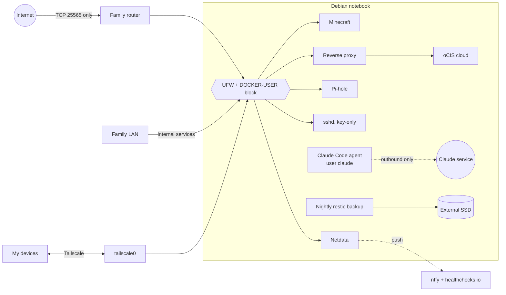

# homeserver

Documentation of my hardened Debian home server: a notebook that runs a game server, a personal cloud, DNS and monitoring for my family, with remote administration through Tailscale and an AI agent.

> **All IP addresses, host names, user names, domains and player names in this repository are anonymized.**
> Example addresses are from the documentation range `192.0.2.0/24`. Placeholders look like `<HOST>`, `<USER>`, `<TAILNET>`.
> No secrets are stored here. Config files are sanitized copies, not the real files.

## Architecture

A larger diagram is in [docs/02-architecture.md](docs/02-architecture.md).

## Status (as of 2026-11-16)

### Done

- Firewall: default deny; only TCP 25565 is allowed from the internet; all other services are reachable from the LAN and the VPN only. Published container ports follow the same policy.
- SSH: key-only, no root, reachable only from the LAN and Tailscale.
- Tailscale: GitHub login with two-factor authentication, three devices (server, phone, laptop, all mine), device approval on, Tailscale SSH off, route to the server only (checked 2026-11-16).
- Remote access through Tailscale, one manual router forward (the game port, checked 2026-11-15).
- Automatic security updates for Debian and Tailscale.
- No privileged containers, no Docker socket in containers. Secret files have mode 600.
- Minecraft with whitelist and online mode. The server build is updated by hand.
- Pi-hole web password moved out of the compose file into a `.env` file (mode 600) and rotated, 2026-11-15 (confirmed by the owner).
- Nightly encrypted backup (restic) to an external SSD, with monitoring of its age.
- Push alerts (ntfy) and an external heartbeat (healthchecks.io).
- The AI agent account has a sudo allowlist of exact commands (no shell, no root file changes) instead of passwordless root-equivalent sudo (since 2026-11-15, tested).
- Lynis baseline measured: hardening index 68 (see [docs/09](docs/09-audit-results.md)).
- One restore test done (2026-11-01).

### Known limitations

- **A deploy key exists on the `claude` account** (one repository, write access, no passphrase, created 2026-11-16, replacing an earlier key that was deleted). The key is a file of that account, so anyone who controls the account can read it. Mitigation: scope of one repository, a GitHub ruleset on `main` (no deletion, no force-push, no pull-request requirement because the deploy key pushes directly, active as stated by the owner 2026-11-16), revocable at any time. The private key is excluded from the backup (done and verified with a restic dry run).
- **Claude account is the main attack path** (T6). Login needs a one-time code sent by e-mail, and that e-mail account has two-factor authentication (stated by the owner, 2026-11-16). The Claude account itself has no second factor of its own that I can claim. A passkey or second factor on the Claude account is being considered, not decided.
- **No off-site backup copy.** Server and backup SSD are in the same place. Do not delete the original photos before a copy exists.
- **Server SSD is not encrypted.** Theft is an accepted risk (T11).
- Several container images use `latest` tags. Updates are applied by hand.
- Minecraft port is public by design (T1).
- Services are reachable from the whole family LAN. No guest or IoT segment, and the router is not under my control (T4).
- UPnP is enabled on the family router on purpose (other devices need it, not under my control). The forwarding table (one manual forward, TCP 25565, checked 2026-11-15) does not prove what is exposed, so exposure is judged by external scans (T4, [04 N3](docs/04-network-access.md)).
- Tailscale clients can reach all host ports: the tailnet ACL is the default allow-all (checked by the owner 2026-11-16). A compromised phone or laptop reaches every server port, but not the home LAN (the route covers the server only). Possible hardening: ACLs. The server's key expiry is disabled on purpose, so a stolen server must be removed in the admin console (T5).
- Server uses Wi-Fi, not Ethernet (T10). Outages of a few seconds were measured.
- There are no alerts for security-relevant events yet.
- The backup-age alarm and the heartbeat alarm for missing pings were never tested. A real long power outage was never tested.
- No regular restore test yet.
- External scan (2026-11-16, mobile network, TCP connect scan of ports 1-30000): `25565/tcp` open, the other 29,999 scanned TCP ports filtered (no response). **Limits:** TCP ports above 30000, UDP and the view from inside the LAN are not covered. UPnP stays enabled on the router, so this is a point-in-time result that the owner repeats from time to time.

### Planned

- Updates are applied manually; a monthly routine is planned, with an update-check script later.
- A manual restore test every quarter.
- Tests for the backup-age alarm and the heartbeat alarm.
- An off-site copy of the backup.
- Alerts for security-relevant events.
- Alert muting is being reworked.
- SSH forwarding will be disabled.
- Tighter access rules for the VPN (tailnet ACLs) are possible.
- A passkey or second factor for the Claude account is being considered.
- A scan from inside the LAN and a UDP scan, and repeated external scans.
- A second Lynis measurement after the next round of measures.
- A RAM upgrade.
- A step-by-step guide to reproduce the setup on a fresh Debian install, with a reuse checklist and a generic sudo-allowlist template for AI agents.

### Considered, not needed

- **Fail2ban** is not used, because SSH is only reachable with a key and only from the LAN and Tailscale.
- GRUB password and malware scanner: not planned (see [docs/09](docs/09-audit-results.md)).

## Documents

| File | Content |
|---|---|
| [docs/01-threat-model.md](docs/01-threat-model.md) | Assets, threats T1-T13, attack surface |
| [docs/02-architecture.md](docs/02-architecture.md) | Hardware, software, diagram, services |
| [docs/03-hardening.md](docs/03-hardening.md) | System hardening measures |
| [docs/04-network-access.md](docs/04-network-access.md) | UFW, Docker firewall block, Tailscale |
| [docs/05-services.md](docs/05-services.md) | Docker stacks, Minecraft, cloud storage, Pi-hole |
| [docs/06-remote-claude-code.md](docs/06-remote-claude-code.md) | How the AI agent runs and its limits |
| [docs/07-backup-restore.md](docs/07-backup-restore.md) | Backup design and restore steps |
| [docs/08-monitoring-logging.md](docs/08-monitoring-logging.md) | Netdata, alerts, heartbeat, logs |
| [docs/09-audit-results.md](docs/09-audit-results.md) | Lynis baseline and after-measurement |
| [CHANGELOG.md](CHANGELOG.md) | Changes to this repository |
| `configs/`, `scripts/` | Sanitized configs and scripts. See [scripts/README.md](scripts/README.md). |

Every measure in docs 03-08 follows the pattern **Threat (ID) → Solution → Configuration → How verified**.
