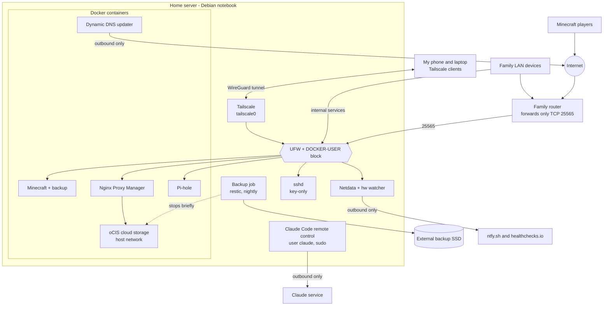

# 02 - Architecture

## Hardware and software (rough)

| Item | Value |
|---|---|
| Machine | Notebook used as a home server (lid closed, always on mains power) |
| CPU | AMD Ryzen 5, 6 cores / 12 threads |
| RAM | 8 GB (one module, one free slot). Memory is tight. |
| Internal disk | 256 GB NVMe, LVM, ext4, not encrypted |
| Backup disk | External 500 GB SSD (USB), ext4 with a restic repository |
| OS | Debian 13, systemd |
| Network | Wi-Fi to the family router. The Ethernet port is not used. |
| Firewall | UFW (iptables backend) plus a custom `DOCKER-USER` block |
| Remote access | Tailscale and SSH (key-only) |
| Containers | Docker Engine with the compose plugin |
| Monitoring | Netdata, a small hardware watcher, ntfy push alerts, healthchecks.io heartbeat |
| AI agent | Claude Code (remote control), dedicated account `claude` |

Checked on the system on 2026-11-12: OS, CPU, RAM, disks, interface state (Wi-Fi up, Ethernet down).

## Diagram

## Services

| Service | Purpose | Reachable from |
|---|---|---|
| Minecraft (Paper) with whitelist | Game server for friends. A second container makes daily world archives. | Internet (game port) |
| Nginx Proxy Manager | Reverse proxy for the internal cloud name. Blocks non-LAN clients for that name. | LAN, Tailscale |
| oCIS (ownCloud Infinite Scale) | Personal cloud storage for photos and files | LAN, Tailscale |
| Pi-hole | DNS server with ad blocking for the household | LAN, Tailscale |
| Dynamic DNS updater | Keeps a public name pointing to the home IP address (used for the game server) | Outbound only |
| Tailscale | Remote access to SSH and web UIs without port forwarding | Tailnet |
| Netdata | Metrics and dashboard. A small web page on a spare phone shows the status. | LAN |
| `mca-hw-watch` | Watches power, battery, CPU temperature and Wi-Fi. Sends push alerts and a heartbeat. | Local, outbound |
| `mca-backup` (systemd timer) | Nightly encrypted backup to the external SSD | Local |
| Claude Code remote control | An AI agent for administration. See [06](06-remote-claude-code.md). | Outbound only |

Details: [04 network access](04-network-access.md), [05 services](05-services.md).
